 

### `bernardo@github:~$ ./contributions.sh`

 

### `bernardo@github:~$ whoami`

<table>
  <tr>
    <td valign="top" width="360">
      
    </td>
    <td valign="top" width="560">
      
    </td>
  </tr>
</table>

 

### `bernardo@github:~$ ./projects.sh`

| status | project |
| --- | --- |
| `ready` | Profile README generator and terminal SVG artwork |
| `pending` | Add confirmed highlighted repositories |

 

### `bernardo@github:~$ ./contact.sh`

[GitHub](https://github.com/Bernardo-Txa)

<!--
Update confirmed profile facts in scripts/profile_config.py.
Regenerate static SVGs with: python scripts/generate_static_art.py
Refresh contribution data with: python scripts/fetch_contributions.py && python scripts/render_heatmap_svg.py
-->
